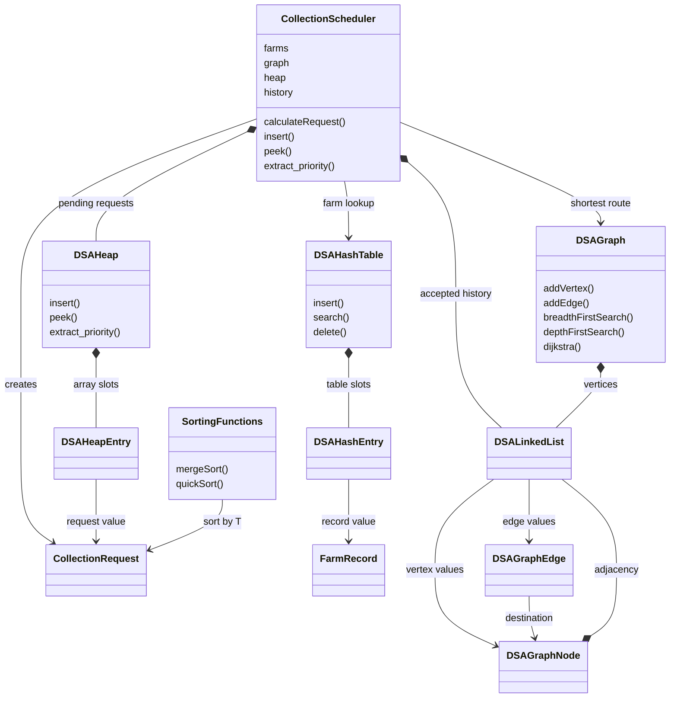
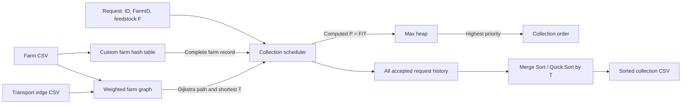

# Report preparation guide: Biogas Feedstock Collection Network

This is a factual working guide for writing and explaining your own technical
report in LaTeX/Overleaf. It is not the finished submission report. Use this guide,
`RESULTS.md`, the source code, and saved output together. Do not invent test results,
field measurements, source verification, a page limit, or missing rubric criteria.

## 1. Current scope and submission facts

The supplied brief asks for four integrated backend modules in Python or Java:
an adjacency-list graph, a farm hash table, a collection binary heap, and Merge/Quick
Sort reporting. Our version uses Python with only the standard library. It has a
console menu rather than a graphical interface. CSV exports store collection
records; the tasks do not specify a database engine, SQL schema, web interface,
vehicle routing optimizer or GIS implementation.

Visible assessment total: 40 marks. The visible hash, heap and sorting criteria are
6 marks each, report 8 and code quality/compliance 6. These visible areas sum to 32.
The remaining 8 are consistent with the graph module but its actual rubric rows
are missing from this PDF. The PDF ends page 8 mid-list and begins page 9 partway
through the rubric; Sections 10–12 are absent. Check the complete brief before
final submission. Do not describe an inferred graph breakdown as confirmed.

The stated deadline is 30 October 2026, 23:59 AWST; CAP students receive 7 extra
days. Both Blackboard links are required: report PDF to Turnitin; ZIP to the
assignment link. The Declaration of Originality must be the report's first page.

Author/date/purpose headers are intentionally absent from code at your request.
They are explicitly required by the visible Code Quality section and must be
added later before submission. Algorithm/practical-reuse comments remain.

## 2. Suggested report structure

1. Declaration of Originality (use the unit's prescribed form, first page).
2. Introduction and system purpose.
3. Dataset provenance, chosen WA region, hub, network construction and modelling assumptions.
4. System design and UML/data-flow figure.
5. Graph: representation, algorithms, tests and complexity.
6. Hash: hash function, table size, collisions, resizing, tests and complexity.
7. Heap: priority formula, integration, heap operations, trace and edge cases.
8. Sorting: implementations, input preparation, timing protocol, results and comparison.
9. Integrated test results and hostile-review findings/fixes.
10. Limitations, design trade-offs and reflection.
11. References; selected trace excerpts/extra results in appendices if needed.

No report length/page limit is visible in this supplied copy. Check the full brief
rather than assuming one. Use concise examples in the body and reference the
complete logs in the submitted ZIP.

## 3. Data provenance and modelling (explain accurately)

### 3.1 Farm source and selection

- Original supplied file: `farm_dataset_sample.csv`, 229 records, all WA,
  229 unique IDs; original file is preserved unchanged.
- Selected file: `data/dataset.csv`, exactly 40 records.
- Selection: first 40 eligible rows in source order. Require WA, status Open,
  no "unconfirmed" in category/species, a species of Cows/cattle, Pigs, Sheep or
  Goats, and no "proposed" in the name. The state-wide WA region is allowed by the brief.
- These rules make a manageable red-meat-related educational dataset. They do
  not establish real waste availability, permission to collect, or current operation.
- All columns are copied intact. FarmID is never reassigned, lowercased or trimmed.
  Required CSV `Id` maps to `FarmRecord.farm_id`.
- Stored required attributes: ID, name, species, latitude, longitude, street number,
  street, suburb, state, postcode, country. Status, map URL and profile URL are
  also stored. The selected CSV retains other original columns as provenance.
- Blank source street/address fields are retained. No replacement values are fabricated.
- Website field formats are retained: for example postcode text may be `6311.0`.
  Latitude and longitude are converted to finite numerical values for computation.
- The source-wide CSV has some blank species, but selected rows have eligible species.
- Record URLs connect the supplied rows to Farm Transparency Project facilities.
  A sample public listing was checked during development; the implementation does
  not scrape the website or independently verify every record.

**Unresolved source compliance:** Section 3.2 says to collect farm data from the
website, and describes this supplied CSV as an example. Our code uses your supplied
CSV. Confirm whether selecting from it fulfils your unit's collection requirement;
otherwise collect/verify the selected records against their retained links and
record the actual access date. Do not claim this work has independently collected
or verified all 40 records. This point can affect data-dependent module marks.

### 3.2 Hub choice

Hub label: `HUB`; modeled as a proposed Kwinana-area hub at latitude -32.23,
longitude 115.78. These are illustrative coordinates, not a verified processing
facility/site. The region and hub choice do not themselves affect marking.

Rationale to discuss: a southwest WA industrial-area scenario gives a plausible
central destination for the model and a clear common target for Dijkstra. Entire-WA
sampling includes distant farms, so this is a data-structure demonstration rather
than an economically optimized collection catchment. If making factual claims
about Kwinana infrastructure, obtain and cite a reliable external source yourself;
the code does not establish those claims.

### 3.3 Network topology and transportation estimates

Let selected farms in CSV order be f0,…,f39.

- Insert all 40 farms plus HUB: 41 vertices.
- Add HUB–f0, then fi–f(i+1) for i=0,…,37: 39 edges.
- Add HUB–f10, HUB–f20, HUB–f30: 3 edges.
- Add fi–f(i+2) for i=0,3,6,…,36: 13 edges.
- Total: **55 undirected edges**. Each is stored in both adjacency lists,
  so there are **110 adjacency entries**.
- Leave f39 (`404a0`, Mogumber Piggery) isolated. This is intentional test modelling,
  not a claim that the real farm has no road access.
- The chain gives a connected hub component; chords create cycles and alternate
  weighted routes; hub links give shortcuts. CSV order makes the model deterministic.
- The graph has 40 hub-reachable vertices (39 farms plus hub) and one isolated farm.

This topology is deliberately an educational test network rather than a validated
road map. No claim is made that each chosen connection is a direct road or that
CSV-order neighbors are geographically adjacent.

For a connection between coordinates, `prepare_data.estimatedMinutes` uses:

\[
a=\sin^2\!\left(\frac{\Delta\phi}{2}\right)
 +\cos\phi_1\cos\phi_2\sin^2\!\left(\frac{\Delta\lambda}{2}\right),
\quad d=6371\cdot2\operatorname{atan2}(\sqrt a,\sqrt{1-a}).
\]

Angles are radians, d is great-circle kilometres. Clamp a into [0,1] for rounding.
Road-factor estimate and assumed speed:

\[
T_{edge}=\max\left(1,\operatorname{round}\left(\frac{1.3d}{60}\cdot60,2\right)\right)
=\max(1,\operatorname{round}(1.3d,2))\ \text{minutes}.
\]

1.3 is an assumed distance multiplier; 60 km/h is an assumed constant speed.
The one-minute minimum guarantees a positive edge even for coincident coordinates.
These are choices to document, not measured data. We ignore traffic, road restrictions,
truck capacity, unloading time, fuel, return journeys, farm hours and collection costs.
The scheduler's T is the shortest **one-way** farm-to-hub time over these model edges.

### 3.4 Collection-request data

`data/collection_requests.csv` contains 12 valid requests `R001`–`R012` for the first
12 farms and seven intentional invalid cases. Valid F is
`10 + (index * 7) % 31`, measured in educational **model tonnes**. No actual production
values are attributed to the website. Exact F, T, priority and order appear in
`RESULTS.md` and `figure_data/priorities_and_collection_order.csv`.

Invalid rows: repeated request ID, second pending request for the same farm,
isolated farm, unknown FarmID, empty FarmID, negative feedstock and NaN feedstock.
They are test requests, not fabricated farm records.

## 4. Architecture and UML/data flow

The classes keep algorithms separate from input/output:

- `FarmRecord`: validated complete farm information.
- `DSAHashTable` → `DSAHashEntry`: FarmID lookup with double hashing.
- `DSAGraph` → linked list of `DSAGraphNode`; each node has a linked list of
  `DSAGraphEdge(destination, weight)` entries.
- `DSAQueue`/`DSAStack` → `DSALinkedList`: BFS/DFS working structures.
- `CollectionRequest`: request ID, farm ID, F, T, priority, path, status.
- `CollectionScheduler`: farm hash table, graph, hub, max heap and accepted-request history.
- `DSAHeap` → array of `DSAHeapEntry(priority, request, sequence)`.
- `mergeSort`/`quickSort`: sort request arrays by ascending transport_time.
- `DataLoader`: CSV parsing/loading/export; `main.py` contains the menu and invokes operations.

Use this as the factual UML basis (arrows express actual relationships):



`SortingFunctions` represents functions in `DSAsorts.py`, not an implemented class.
Label it as a module in a polished diagram. Avoid showing every helper; the required
figure should make the four-module interaction and data flow clear.

Data-flow figure:



## 5. Module 1: graph explanation

### Representation and operations

Graph vertices are stored in our linked list. A vertex has an insertion index and
a linked list of weighted edges with **direct destination-node references**.
Undirected insertion creates two entries but increments the edge count once.
Indices address scratch arrays for levels, colors, distances and predecessors.
Vertices are added dynamically; graph deletion is not a required task and is not
implemented. Duplicate labels/edges, self-connections, missing endpoints and invalid
weights raise controlled errors. Endpoints must exist; addEdge does not invent farms.

### BFS

Use a custom FIFO queue. Initialize levels to -1. Set source level 0 and enqueue it.
When an unvisited neighbor is discovered, set its level to current+1 and enqueue it.
Return (FarmID/label, level) in BFS order and print grouped levels. This is minimum
**edge count**, not minimum transportation time. Only the source component is reached.
An isolated source yields just level 0. Unknown source gives a clear error.

### DFS and cycle detection

Use our explicit linked-list stack storing `(vertex, neighbor_iterator)`, with
colors 0=unvisited, 1=active stack path, 2=finished. Skip the parent edge when checking
an undirected cycle. An edge to an active ancestor indicates a cycle; follow parent
pointers to reconstruct it and repeat the start node to show closure. Traverse the
source component first, then remaining unvisited components, so a cycle in a
disconnected component is detected. Return visit order and one cycle (not every cycle).

The iterative stack avoids Python's recursion limit. A 1,100-vertex path regression
test passes; the first draft's recursive DFS failed this hostile-review case.

### Dijkstra

Initialize source distance 0, all others infinity; all predecessors empty. Repeatedly
scan vertices to choose the unfinished vertex with minimum finite distance. Relax
each incident edge, updating distance and predecessor if a shorter route is found.
Stop when target is finalized or no finite unfinished vertex remains. Build the path
by following predecessors backwards and inserting at the linked-list front.

No built-in shortest-path routine or priority queue is used. Linear selection is
easy to explain and adequate for 41 vertices, though less scalable than a heap-based
implementation. The same-location result is 0 minutes with a singleton path.
Unreachable is `(infinity, empty path)` and the menu prints a no-route message.
All edges must have finite positive weights. Overflowing alternative sums are skipped;
if the target is connected but no path total fits a finite float, return a controlled
numerical-range error rather than falsely saying disconnected.

### Evidence

`sample_output/graph_tests.txt`: full graph, BFS levels, DFS order/cycle, real-farm
path, unreachable farm and fixture tests. Independently known fixture:
`A–C–B–D–E`, time **7**, better than routes using the expensive A–B and C–D edges.
It also tests a disconnected cycle, a tree whose parent edges are not cycles,
same-source/target, invalid endpoints/weights and the long DFS path.

## 6. Module 2: hash explanation

### Design choice

Double hashing, adapted from Practical 7, avoids allocating chains and reuses our
familiar probing design. Each slot stores key, complete FarmRecord and a state:
FREE (never used), USED or DELETED (tombstone). IDs must be nonempty ASCII alphanumeric
strings, matching this source dataset. No lowercasing/normalization changes website IDs.
Duplicate insertion is rejected, preserving the existing record rather than silently
overwriting. Search returns the complete FarmRecord; missing search/delete raises
KeyError handled by the driver/menu.

### Exact hash function and prime choice

For a key k with character codes c0,…,c(L−1), compute the polynomial hash modulo m:

\[
h_0=0,\qquad h_{j+1}=(31h_j+\operatorname{ord}(c_j))\bmod m.
\]

Compute primary Hm(k) with m=table size. Compute secondary H(m−1)(k) and
`step = 1 + H(m-1)(k)`. Probe:

\[
\operatorname{index}(i)=(H_m(k)+i\cdot\operatorname{step}(k))\bmod m,
\quad i=0,1,\ldots,m-1.
\]

The prime capacity m and step in [1,m−1] make the step coprime to m, so the sequence
can visit every slot. Taking modulo at each character avoids huge integer hashes.
Initial prime m=53 permits the required records while deliberately demonstrating
growth. Before an insertion that would exceed load 0.7, resize to the next prime at
least 2m, then rehash all USED records. Here 53 grows to 107 before insertion 38.
Deleted slots are discarded during rehash. Rehashes do not count as new user inserts.

Load factor is live-record count / capacity. It prints after every 10 successful
insertions, including after resizing. Duplicate/rejected inserts do not increment
the count. Actual load factors and probe examples are in `RESULTS.md`.

### Deletion and collision example

Search stops at a FREE slot, but passes a DELETED slot; otherwise deleting a colliding
entry could make later keys unreachable. Insertion remembers the first tombstone
but still searches for duplicate keys. The probe loop is bounded by capacity.

Real IDs `qlctx` and `c1c13` initially collide at slot 45 for capacity 53.
`sample_output/hash_tests.txt` prints the occupied state, secondary probes, successful
insertion, tombstone deletion, continued search and tombstone reuse. Also includes
40 insertions, 40 record round-trip searches, failed searches/deletes, duplicates,
coordinate validation, load-factor changes and growth to 107.

No shrinking is implemented (not required). A deletion-heavy workload can leave many
tombstones and slow probing; growth rehash clears them. State this assumption when
discussing expected O(1), rather than claiming constant time regardless of workload.

## 7. Module 3: heap and scheduling explanation

### Formula and integration

For a request, validate request ID and positive finite feedstock F, look up FarmID in
the custom hash table, obtain Dijkstra's shortest time T to HUB, then compute:

\[
P=\frac{F}{T},\qquad F>0,\ T>0.
\]

P has model tonnes/minute units. Increasing F with T fixed increases priority;
increasing T with F fixed reduces priority. It represents feedstock availability
relative to transport time, which matches the brief's direction requirements.
It is not a full profit/emissions/vehicle-scheduling optimization.

Unreachable farms are rejected explicitly. Zero T is rejected because F/T is
undefined; the test obtains zero by using the same source and hub location, not
by inserting a forbidden zero-weight graph edge. Invalid/nonfinite F or calculated
priority is rejected. Transport times and priorities are calculated, never typed
as final priorities by the menu.

### Heap operations

An indexed Python list of capacity 100 stores our heap entries. This list is used
as an array: heap positions are managed by index and count, not append/pop priority
operations or library heap functions. Children of i: 2i+1 and 2i+2; parent:
floor((i−1)/2). Highest priority is at index 0, hence a max heap is natural.

- Insert at the next free position, then swap upwards while higher than parent.
- Peek returns root without removal.
- Extract returns root, moves last item to root, clears the old slot and swaps down
  with the higher-priority child until the property is restored.
- Print the heap array after every successful insertion and extraction.
- Equal priorities compare insertion sequence; earlier insertion comes first (FIFO).
- Empty peek/extraction and full capacity raise controlled ValueError.

The fixed capacity is sufficient for the required run; it is not an unlimited queue.
The sorting experiment creates historical model records without placing 1,000
simultaneous requests into this heap.

### Duplicates, history, deletion and snapshots

Request IDs are unique across accepted history, including completed requests. A farm
can have at most one pending request. After extraction a new request ID for that
farm is allowed. This is a documented policy, because the brief leaves duplicate
handling to our design. Failed insertions do not enter accepted history.

Scheduler.peek/extract rechecks farm lookup when a request reaches the root. If that
farm was deleted, extract and mark that request CANCELLED, print the heap state and
cancellation message, then continue to the next candidate. This prevents collection
using missing records. Pending entries below the root are checked when they reach it.
This checks current presence: if the same FarmID is reinserted before reaching the
root, the old request remains eligible with its original route/time snapshot. A
still-missing FarmID is cancelled. No permanent deletion-history registry is used.
All accepted requests remain in linked-list history with PENDING, COLLECTED or
CANCELLED status. The record export sorts this complete accepted history by T.

Scheduling uses a snapshot of T/path/P at acceptance. Adding graph connections
does not reprioritize old requests. Farm-info deletion retains the geographic graph
node and transport edges, since removing database information does not necessarily
close a transportation connection. No graph removal/live route updates are required.
Menu edits last for the session; they do not overwrite source farm data.

### Evidence

`sample_output/heap_tests.txt`: 12 accepted insertions and all array states/priority
calculations, first five required extractions and complete ordering, duplicates,
unreachable/missing/invalid data, empty heap, equal ties, deleted records, zero T and
capacity overflow. Required first five requests: **R011, R003, R004, R001, R009**.
Exact F/T calculations and complete order are regenerated in `RESULTS.md`.

## 8. Module 4: sorting and experiment explanation

### Implementations and choices

**Merge Sort:** top-down divide at the midpoint, recursively sort both halves,
merge into a single temporary array and copy back. When equal keys are encountered,
take the left item first (`<=`), preserving equal-key input order: stable.
One temporary array of n entries is allocated per call. Chosen for predictable
O(n log n) behavior and a straightforward divide-and-conquer explanation.

**Quick Sort:** choose the median of left, middle and right transport-time values.
Use Hoare two-way partition: move left/right scans until misplaced/equal items,
swap and advance; return split boundary when scans meet. Scans advance even for
equal keys, avoiding an infinite loop on duplicate transport times. Recurse into
the smaller side and iterate over the larger side to keep stack depth O(log n).
Median-of-three avoids the obvious first/last-pivot weakness on monotonic data,
but does not guarantee balanced partitions on all adversarial inputs.

Quick Sort is **not stable**: its swaps can reverse equal-time records. Our report
needs ascending T, so either ordering of equal keys is correct. If preserving the
arrival order of equal times matters, prefer Merge Sort. Do not falsely claim that
both sorts always produce identical request order for ties.

The earlier Practical 1 Merge/Quick functions were placeholders. They have been
implemented here, rather than claiming they were already working practical code.
HeapSort from Practical 8 is not used to satisfy this module.

### Integrated input generation

Three sizes: 100, 500, 1,000. Records are model collection requests drawn from the
39 reachable farms. Feedstock uses deterministic pseudorandom integers 5–50.
Each record calls the same scheduler calculation: hash lookup plus Dijkstra.
Repeated FarmIDs are allowed as **different historical/model collection events**;
these benchmark records are not simultaneously pending requests in the live heap.
Each has a unique RequestID. Thus 1,000 records does not require 1,000 farms.
If a user adds a farm record before adding/connecting its graph location, benchmarks
skip that record until it has a positive route to the hub. This is regression-tested.

Inputs contain repeated T keys because different requests can use the same farm.
This is a meaningful property affecting partition behavior and stability.
Data-generation time is excluded from sort timings.

Use dedicated `random.Random` instances (not uncontrolled global randomness):

- base seed = 5008;
- base records for size n use `5008+n`;
- benchmark condition c (0=random, 1=nearly sorted, 2=reversed) uses `5008+n+c+1`.
- regeneration with identical code/data/runtime preserves input choices;
  measured timings are naturally not identical.

For each size, both algorithms receive fresh copies of **the exact same input array**.

Conditions:

1. Random: Fisher–Yates shuffle of base records.
2. Nearly sorted: sort a copy with our own stable Merge Sort, select n/10 distinct
   positions using a seeded shuffle, then swap these positions in disjoint pairs.
   Exactly 10, 50 and 100 record **identities** move from the stable baseline.
   Equal-time records may swap without changing numerical order. This satisfies
   record displacement, not a claim that exactly 10% of keys differ or that a
   particular inversion count is produced. The driver verifies exact displacement.
3. Reversed: sort with our Merge Sort, then swap symmetric positions to make a
   descending/nonincreasing array. Duplicate keys are allowed.

### Timing protocol and saved evidence

`module4_sorting/benchmark.py`:

- 2 algorithms × 3 sizes × 3 conditions = 18 entries.
- One warm-up per algorithm/case, outside measurement.
- Seven measured repetitions; alternate which algorithm runs first.
- A fresh working-array copy is made before starting each timer.
- `time.perf_counter_ns` measures only the sorting call (including its internal
  allocations/recursive work); convert nanoseconds to milliseconds and average.
- Check sorted order and identity preservation after measurement.
- `sameRecords` is an intentionally simple O(n²) independent verification pass;
  it is excluded from measured sorting time, and these sizes make it inexpensive.
- Export the 1,000 random-input records and each algorithm's sorted output.
- Save environment and parameters, so results are attributable to a concrete run.

Results: `sample_output/benchmark_results.csv`, `benchmark_environment.json`,
`benchmark_run.txt`, `sorting_input_1000.csv`, `merge_sorted_1000.csv`,
`quick_sorted_1000.csv`. Use the table in `RESULTS.md`; rerunning changes timings.

### Answer all seven analysis questions

1. **Size growth:** compare each algorithm within each condition at 100/500/1000;
   discuss observed growth, then relate it to n log n without claiming measured
   milliseconds prove an asymptotic bound.
2. **Input condition:** compare random, nearly sorted and reversed at a fixed size;
   Merge always performs recursive merge work, whereas Quick partition behavior
   depends on pivot splits and duplicate keys.
3. **Pivot influence:** explain median-of-three, typical improved ordered-data
   partitioning, and retained adversarial worst case.
4. **Theoretical time:** Merge Θ(n log n) in all cases for this implementation;
   Quick typical/average Θ(n log n), worst Θ(n²).
5. **Worst behavior:** Merge keeps its guarantee; Quick can repeatedly create
   unbalanced partitions even with median-of-three. This experiment need not
   observe worst-case Quick Sort.
6. **Space:** Merge O(n) temporary array + O(log n) recursion; Quick uses in-place
   swaps + O(log n) stack because this implementation recurses on the smaller side.
   Do not copy a generic O(n) worst-stack claim without noting our loop optimization.
7. **Input characteristics:** size, degree of initial order, duplicates, distribution,
   pivot splits, Python overhead, and short-duration timing noise. Distinguish
   algorithm effects from external noise; do not make universal speed claims.

Conclude with a reasoned choice: stable predictable reporting favors Merge Sort;
lower auxiliary memory favors this Quick Sort when tie stability is unnecessary.
Tie the choice to this data, not just a winner in one timing row.

## 9. Time and space complexity (match the actual code)

Notation: V vertices, E undirected edges, n sorting records, R pending requests,
H accepted historical requests, m hash capacity, C heap capacity, L ID length.
Auxiliary space excludes stored input structures unless stated.

| Operation | Time | Space/qualification |
|---|---|---|
| Graph storage | — | O(V+E); every undirected edge stored twice |
| Graph label lookup / vertex insertion | O(V) | Linked-list vertex lookup/duplicate check |
| Edge insertion | O(V+degree(u)+degree(v)) | Two label lookups and adjacency checks; O(1) new entries |
| BFS | O(V+E) | O(V) levels/queue/output; source component only |
| DFS cycle detection | O(V+E) | O(V) colors/parents/explicit stack/order/cycle; all components |
| Dijkstra | O(V²+E) | O(V) scratch/path; linear minimum scan, not a heap implementation |
| Hash calculation | O(L) | O(1) arithmetic workspace; L small for supplied IDs |
| Hash search/delete | Expected O(1) for fixed L; worst O(m) | Assumes suitable distribution and moderate probe occupancy |
| Hash insert without resize | Expected O(1); worst O(m) | Duplicate check + probing; formatting/probe trace adds overhead |
| Hash resizing | Expected O(m+n) rehash work | Old/new arrays O(m+n); prime-search work additional; pathological collisions worsen time |
| Hash insert amortized | Expected O(1) for fixed L | Geometric capacity growth; one resize insert costs more |
| Hash storage | — | O(m) slot objects plus farm records |
| Heap insert/extract algorithm | O(log R) | O(1) percolation workspace; O(C) backing array overall |
| Heap peek algorithm | O(1) | O(1) workspace |
| Required heap trace | O(R) | O(R) formatted output; adds time to each traced operation |
| Scheduler acceptance | O(H+R+V²+E+log R) | History/pending duplicate scans + hash lookup + Dijkstra + heap; trace adds O(R) |
| Scheduler peek with k deleted roots | O(1 + k log R) algorithm work | Expected O(k+1) hash checks; required cancellation traces add O(kR) time/output |
| Scheduler extract after k cancellations | O((k+1) log R) heap work | Expected O(k+1) hash checks; required traces add O((k+1)R) time/output |
| Merge Sort | Θ(n log n) | O(n) buffer + O(log n) call stack; stable |
| Quick Sort | Average Θ(n log n); worst Θ(n²) | O(log n) stack in this version; unstable |

Report the raw heap/hash algorithm bounds separately from full-system overhead.
Printing after operations is explicitly required but prevents claiming the total
traced heap insertion is O(log R). Expected O(1) farm lookup is not guaranteed in
collision-heavy or tombstone-heavy worst cases. The linear graph construction and
Dijkstra are acceptable for this educational size but not optimized for huge networks.

## 10. Testing, hostile review and evidence mapping

Run from `Assignment/`: `python3 run_tests.py`. It fails on a violated check and saves
all seven logs/results. No manual entry is required to reproduce assessed scenarios.
Use `python3 main.py` for the interactive demonstration.

`sample_output/input_tests.txt` separately checks missing headers/files, truncated
farm/request rows, invalid coordinates/endpoints, recovery after a bad request row,
invalid menu choices/missing records/empty heaps, launch from a different working
directory and clean EOF exit. These tests are included in the standard run.
They also exercise all menu options and both sorted exports from an isolated copy,
and verify recovery from CSV parser errors. The final benchmark regression covers
farm insertion before graph registration, isolated new locations and later connection.

| Visible requirement / marks | Implementation | Evidence |
|---|---|---|
| Real single-region dataset, original IDs, ≥40 records | prepare_data + FarmRecord + farm CSV | 40 exact WA source rows, retained map/profile links; provenance caveat above |
| ≥10 vertices, ≥12 positive weighted edges, cycle + isolated location | DSAGraph / transport CSV | graph_tests; 41/55, cycle and isolated 404a0 |
| Weighted undirected adjacency list; dynamic insertions | DSAGraph.addVertex/addEdge | graph_tests checks both directions; menu options 16/17 |
| BFS levels | breadthFirstSearch/displayBFS | graph_tests and bfs_levels.csv |
| DFS cycle locations/disconnected handling | depthFirstSearch | graph_tests, detected closed cycle + disconnected fixture |
| Dijkstra path/time/invalid/unreachable | dijkstra | known 7-minute fixture, farm path, isolated and invalid tests |
| Hash insert/search/delete (3) | DSAHashTable | hash_tests: all records, success/failure/delete/reinsert |
| Collision with intermediate state (1) | double hashing trace | hash_tests: qlctx/c1c13, probes/tombstone |
| Hash design/scalability (2) | prime m, modulo hash, resize | 40 records, loads each 10, 53→107; guide justification |
| Hash ID/name/coordinate/missing validation | FarmRecord/hash table | hash_tests including NaN/inf/bool/range/boundary |
| Heap insert/extract correct (2) | DSAHeap | heap_tests, heap property and FIFO ties |
| Priority integration (2) | CollectionScheduler | F/T computed via hash + Dijkstra, integration_tests |
| Heap tracing (2) | insert/extract print array | ≥10 inserts/≥5 extracts, heap_tests and heap_states.csv |
| Heap edge cases | scheduler/request/heap validation | heap_tests incl duplicate/missing/unreachable/zero/deleted/full/empty |
| Sorting correctness (3) | mergeSort/quickSort | sorting_tests and both 1,000-row exports |
| Sorting performance/analysis (3) | benchmark + this guide + RESULTS | all 18 rows, all sizes/conditions/seed, measured vs theoretical |
| Integration, required UML | CollectionScheduler/history/menu | integration_tests, diagrams in Section 4 |
| Report overview/justification (2) | Sections 2–8 | Transfer into your own report |
| Report UML/data flow (2) | Section 4 | Render and include a clear figure |
| Report complexity/reflection (2) | Sections 8–9/12 | Actual implementation bounds and trade-offs |
| Report results/assumptions/limits (2) | RESULTS + Sections 3/12 | Tables, traces, realistic scope |
| Modular/readable/documented code (2) | Separate modules/classes/drivers/menu | Source + README; author/date/purpose headers still to add |
| Testing and edge cases (2) | module drivers/integration | Saved logs plus independent hostile reviews |
| Error handling (2) | validators/exceptions/menu | Invalid values rejected, menu continues; EOF cleanly exits |
| Packaging and two submission links | README/final checklist | Final PDF/ZIP and submission still to do |

Three independent reviewers performed read-only requirements, algorithm and
test/evidence audits during development. Their checks
included randomized hash insert/search/delete against a reference oracle, stable
heap ties and invariant checks, sorting adversarial arrays/permutations, all-pairs
Dijkstra against an independent shortest-path oracle, disconnected cycle checks,
dataset exact-row matching, and a full menu session. Some reviewer oracles used
built-in structures only in their temporary test scripts, not assignment core code.

Review-found fixes included recursive-DFS overflow (replaced with an explicit stack),
controlled huge-number conversion errors, and an irrelevant overflowing route
branch that originally hid a finite destination path. Regression cases are now in
the submitted graph/hash/heap drivers. Independent temporary review scripts are
not part of the deliverable; reproducible required tests live in the module drivers.
Use these as validation facts, not a claim that reviewers guarantee a grade.

## 11. Generated figures and report placement

The figures are now generated with Matplotlib in `report/figures/`, using the exact
blue, orange, green and purple palette extracted from your supplied paper.
Each has a vector PDF for Overleaf and a 300 dpi PNG for preview/sharing.

Read [FIGURE_GUIDE.md](FIGURE_GUIDE.md) for the recommended section/placement of
**every figure**, captions, interpretation notes, data sources and LaTeX examples.
The guide distinguishes the required UML diagram from supporting figures and
explains which to prioritize or place in an appendix. The required timing table
must remain in the report even when its plot is included.

| Figure file | Put it in |
|---|---|
| `01_system_uml.pdf` | System design, after introducing the four modules |
| `02_module_data_flow.pdf` | Integration/system design, after the request workflow |
| `03_farm_network.pdf` | Graph design/results, after topology/model assumptions |
| `04_bfs_levels.pdf` | BFS results, or appendix |
| `05_hash_behaviour.pdf` | Hash collision/deletion/resizing discussion |
| `06_max_heap.pdf` | Heap implementation, after priority/percolation explanation |
| `07_collection_order.pdf` | Scheduling results, or appendix |
| `08_sorting_timings.pdf` | Sorting results, alongside the required timing table |

`all_figures_preview.pdf` contains the full set for inspection; embed the individual
PDFs in Overleaf. `figures_manifest.json` records input hashes and plotting metadata.
For regeneration use `python3 report/generate_figures.py` in an environment with
Matplotlib. This plotting dependency applies only to the optional report helper;
the application and tests remain standard-library Python.

## 12. Limitations and reflection to discuss

- Dataset is a supplied sample subset; source collection/verification acceptance
  needs confirmation. Status in source does not guarantee current status.
- Hub, topology, speed, road factor and feedstock values are model assumptions.
- WA-wide sample includes distant farms; source-order chain is not a realistic
  optimized road network. One isolated farm is intentional testing.
- P=F/T captures availability and efficiency but ignores capacity, operating cost,
  multi-stop trips, fairness and perishability. It may prefer nearby smaller loads.
- Requests retain acceptance-time T/P; graph updates do not trigger reprioritization.
- Fixed heap capacity 100 rejects overflow cleanly. Sorting historical events is
  separate from pending capacity.
- Linear vertex lookup/Dijkstra trades scalability for clarity; hash tombstones
  may degrade repeated-deletion workloads; Quick Sort still has quadratic worst case.
- Timing is a local short-duration experiment, not a universal performance ranking.
- Accepted request history is stored; invalid attempts are logged rather than added
  as sortable records because they have no valid T/priority.
- CSV session exports persist records; no automatic persistence of menu mutations.
- Python lists serve as arrays and standard parsing dictionaries are used only for
  CSV/JSON plumbing; check any stricter extra unit rules in the full materials.

For reflection explain why these choices satisfy the brief at a manageable level
you can explain, and identify what you would change for a genuinely large production
network without implementing unrequested features.

## 13. References and self-citation

Use the prescribed referencing style from your unit if provided. The supplied brief
references Cormen et al.; source comments identify practical reuse and algorithm
references. Complete these with your real name/student details only at submission.

- Cormen, T. H., Leiserson, C. E., Rivest, R. L., and Stein, C. (2022).
  *Introduction to Algorithms*, 4th ed. MIT Press. Main reference for graph,
  hash, heap and sorting algorithms. Cite the book where explaining these methods;
  do not claim verbatim implementation from it.
- Farm Transparency Project, [Map](https://www.farmtransparency.org/map).
  Cite supplied dataset origin and individual profile URLs retained in CSV.
  State actual website access dates and extent of verification.
- [Farm Transparency Project feedlot listing](https://www.farmtransparency.org/facilities?tag=Feedlot):
  a public source listing used for a sample source check during development.
- Sedgewick, R., and Wayne, K., *Algorithms, 4th Edition*,
  [official algorithms summary](https://algs4.cs.princeton.edu/cheatsheet/) and
  [official algorithm/code catalog](https://algs4.cs.princeton.edu/code/).
  Useful supplementary algorithm/complexity references. The catalog's heap-based
  Dijkstra bound differs from our deliberate linear-scan implementation; cite our
  actual O(V²+E) bound and explain that difference.
- Your own COMP5008 practicals: Practical 6 linked list/queue/stack/graph interfaces;
  Practical 7 double hashing; Practical 8 array heap; Practical 1 sorting interfaces.
  No BST is required, so Practical 5's tree implementation is not added just for reuse.
- Haversine/great-circle calculation: document the formula and model constants.
  If an external geodesy reference is required, obtain a primary suitable source
  and cite it; this guide does not invent a source for the road-factor assumption.

Example BibTeX (adapt formatting to your style):

```bibtex
@book{clrs2022,
  author = {Thomas H. Cormen and Charles E. Leiserson and
            Ronald L. Rivest and Clifford Stein},
  title = {Introduction to Algorithms},
  edition = {4},
  publisher = {MIT Press},
  year = {2022}
}
@misc{farmmap,
  author = {{Farm Transparency Project}},
  title = {Farm Transparency Map},
  howpublished = {\url{https://www.farmtransparency.org/map}},
  note = {Accessed: replace with your actual verification date}
}
```

## 14. Explain-it-yourself checkpoints

Before a demonstration, be able to answer:

1. Why does an undirected edge need two adjacency entries but count as one edge?
2. Why does BFS level count edges rather than weighted travel minutes?
3. Why must DFS ignore the parent edge, and why scan disconnected components?
4. Why does Dijkstra require nonnegative weights, and why is our scan O(V²)?
5. Why is a tombstone different from an empty hash slot?
6. Why do prime capacity and a nonzero secondary step cover every slot?
7. Why rehash rather than copy slots unchanged during resize?
8. Why does a max heap match P=F/T, and what do up/down swaps restore?
9. How can equal priorities be FIFO without changing their calculated values?
10. Why reject zero/unreachable T and check farms again before collection?
11. Why can a heap array fail to be globally sorted even though the root is highest?
12. How do Merge's equal-key choice and Quick's swaps affect stability?
13. Why can 1,000 request records come from only 39 reachable farms?
14. How is exactly 10% displacement measured and reproduced?
15. Which costs are inside the timing interval, and why can timings vary?

## 15. Final submission checklist (work still required later)

- [ ] Obtain/check full brief: missing graph rubric, Sections 10–12 and any additional restrictions.
- [ ] Confirm supplied-sample dataset satisfies collection requirement; verify retained sources if needed.
- [ ] Confirm Python lists used as indexed arrays are permitted by your unit rules.
- [ ] Note the entry point is now `main.py`, as requested, rather than the brief's
      `interactive_menu.py` filename; README explains this substitution.
- [ ] Add required author/date/purpose headers to each source file with your correct details.
- [ ] Confirm practical/algorithm citations and references are acceptable to the unit.
- [ ] Write your report in Overleaf using actual latest RESULTS, figures and explanations.
- [ ] Include required UML/module interaction figure and timing comparison table.
- [ ] Explain theoretical/observed time, space, stability, pivot, assumptions and limitations.
- [ ] Include Declaration of Originality as the first page, using the correct unit form.
- [ ] Export `technical_report.pdf` and inspect every page/figure/table for legibility.
- [ ] Run `python3 run_tests.py` after final changes; check all logs finish with passes.
- [ ] Ensure report values match the final saved benchmark files (reruns replace timings).
- [ ] Stage a clean `COMP5008_assignment_<studentID>/` directory with README,
      main.py, shared files, data/, four module folders,
      module test drivers/benchmark files, sample_output/, and technical_report.pdf.
- [ ] Exclude `__pycache__`, temporary files, editor metadata and .git.
- [ ] Create `COMP5008_assignment_<studentID>.zip` with that top-level folder.
- [ ] Test the extracted ZIP from a fresh folder, including paths and imports.
- [ ] Submit PDF to Turnitin and ZIP to the separate Blackboard assignment link.

Do not mark the submission complete until these final items are actually done.
